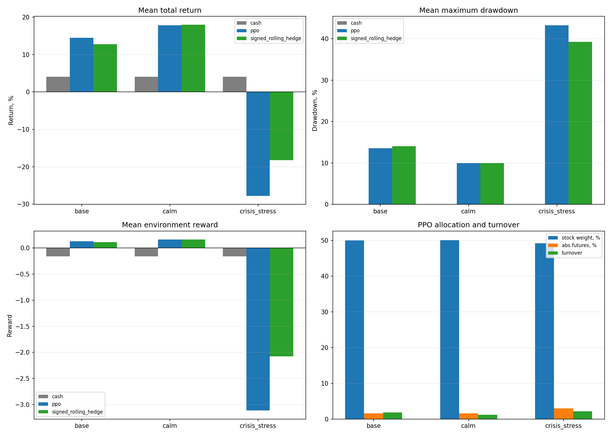

# Reinforcement Learning for Gas Portfolio Hedging

This project studies whether a reinforcement learning agent can manage the risk of a synthetic gas-company portfolio using equity, gas futures, cash, and protective put options. It provides a reproducible Gymnasium environment, benchmark strategies, Proximal Policy Optimization (PPO) training, and scenario-based evaluation with explicit transaction costs, margin constraints, and failure checks.

The repository is designed as a research workflow rather than a single training script: market simulation, portfolio accounting, agent training, validation, stress testing, diagnostics, and experiment tracking are kept as separate components.

## Project objective

The agent must allocate capital across several instruments while balancing return and downside protection. The main research questions are:

- Can a learned policy improve portfolio outcomes relative to simple static or rule-based hedges?
- Does the policy remain solvent after transaction costs and futures-margin requirements?
- How stable is the policy across normal, calm, and crisis-like market regimes?
- Which exposures does the policy use to achieve its results?

The project deliberately treats robustness as part of the result. A policy is not considered successful merely because its average return is positive; it must also satisfy scenario-specific risk and reliability gates.

## Data representation

Experiments use a synthetic market simulator so that regimes and stress conditions can be controlled and reproduced. The simulated state includes:

- gas-company equity dynamics;
- a seasonal gas futures curve;
- cash and financing effects;
- market-regime variables and dividend events;
- protective put options with 10-, 21-, and 63-day maturities, priced with a Black-Scholes model;
- current portfolio weights, hedge exposures, margin state, and risk measurements.

Actions represent portfolio allocations and hedge decisions. The environment converts them into trades, applies costs and constraints, revalues the instruments, and returns a risk-aware reward. Training, validation, and stress scenarios are separated to reduce the risk of judging a policy only on the paths it learned from.

## Methods

The main agent is trained with Proximal Policy Optimization using Stable-Baselines3. The training and evaluation pipeline includes:

- four parallel Gymnasium environments;
- observation and reward normalization through `VecNormalize`;
- a reward that combines portfolio performance with downside-risk and trading penalties;
- transaction costs, option premiums, futures margin, margin calls, and bankruptcy logic;
- periodic checkpoints and deterministic evaluation;
- benchmark policies for unhedged, static, and rule-based allocations;
- bootstrap confidence intervals for evaluation statistics;
- experiment registries and saved diagnostics for reproducibility.

Configuration files in `configs/` define the market, portfolio, training, and evaluation settings. The notebooks provide an exploratory interface, while the scripts and source package contain the reusable implementation.

## Evaluation results

The latest registered reference run (`v4_reference`) was evaluated over 500 validation episodes: 200 base-regime episodes, 200 calm-regime episodes, and 100 crisis-stress episodes.

| Scenario | Episodes | Mean total return | Mean Sharpe ratio | Mean maximum drawdown | Margin-call rate | Bankruptcy rate |
|---|---:|---:|---:|---:|---:|---:|
| Base | 200 | 5.93% | 0.121 | 14.22% | 0.0% | 0.0% |
| Calm | 200 | 10.35% | 0.493 | 7.46% | 0.0% | 0.0% |
| Crisis stress | 100 | 1.75% | -0.050 | 23.38% | 0.0% | 0.0% |

The policy remained solvent in every registered validation episode and produced positive average returns in all three scenarios. However, it did **not** pass the complete acceptance suite because crisis robustness remained below the required performance gates. This is an important negative result: the agent learned a viable hedge allocation, but the evidence does not support claiming production-ready behavior under severe stress.



Detailed evaluation tables, confidence intervals, training curves, and diagnostic figures are stored under `results/ppo/`. The experiment history is available in `results/ppo/registry/ppo_history.csv`.

## Repository structure

```text
configs/        Market, environment, training, and evaluation settings
src/            Simulation, portfolio, agent, and analytics modules
scripts/        Reproducible command-line workflows
tests/          Unit and integration checks
results/        Saved metrics, tables, checkpoints, and figures
00_*.ipynb      Monitoring and visualization
01_*.ipynb      Baseline analysis
02_*.ipynb      Calibration and evaluation
03_*.ipynb      PPO training
04_*.ipynb      PPO evaluation
```

## Running the project

Create a virtual environment and install the dependencies:

```bash
python -m venv .venv
source .venv/bin/activate  # On Windows: .venv\Scripts\activate
pip install -r requirements.txt
```

Run the relevant scripts from `scripts/` or open the numbered notebooks in sequence. The notebooks use `notebook_bootstrap.py` to resolve project paths consistently. Tests can be run with:

```bash
pytest
```

## Limitations and next steps

The environment is driven by synthetic rather than calibrated historical market data, so the results demonstrate research and engineering capability, not live trading performance. The next steps are to calibrate the simulator to real gas and equity data, evaluate across multiple training seeds, strengthen crisis-regime objectives, and perform out-of-sample comparison against realistic hedge benchmarks.

This repository is a research prototype and does not constitute investment advice.
